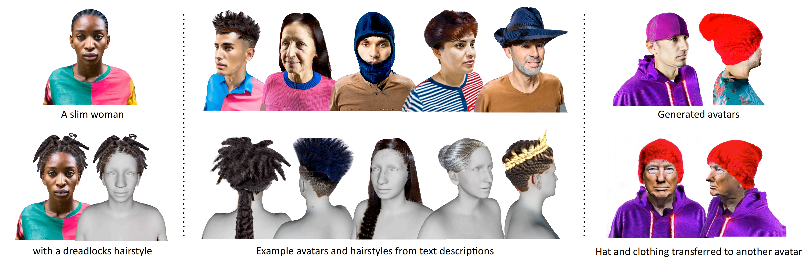

<p align="center">
<h2 align="center">TECA: Text-Guided Generation and Editing of Compositional 3D Avatars</h2>
<p align="center">
<a href="https://haozhang990127.github.io/"><strong>Hao Zhang*</strong></a>
·  
<a href="https://scholar.google.com/citations?user=wNQQhSIAAAAJ&hl=en&oi=ao"><strong>Yao Feng*</strong></a>
·
<a href="https://kulits.github.io/"><strong>Peter Kulits</strong></a>
·
<a href="https://is.mpg.de/person/ydwen"><strong>Yandong Wen</strong></a>
·
<a href="https://justusthies.github.io/"><strong>Justus Thies</strong></a>
·
<a href="https://ps.is.tuebingen.mpg.de/person/black"><strong>Michael J. Black</strong></a>
<br>
    * Equal Contribution
</p>

<h3 align="center">3DV 2024</h4>
 
<p align="center">
    <a href='https://arxiv.org/abs/2309.07125'>
      
    </a>
    <a href='https://yfeng95.github.io/teca/' style='padding-left: 0.5rem;'>
      
    <a href="https://www.youtube.com/watch?v=W7NDJt2HJxM"></a>
    </a>
    <p/>
<br/>
<div align="center">
    
</div>

TECA takes text as input combining mesh and NeRF representation methods to generate realistic editable and animtable avatars.

# Install
- Tested GPUs: RTX A5000, A100, V100 
- Python=3.9, CUDA=11.3, Pytorch=1.12.1

```bash
git clone https://github.com/HaoZhang990127/TECA.git
cd TECA

conda env create --file environment.yaml
conda activate teca
# install pytorch3d
pip install git+https://github.com/facebookresearch/pytorch3d.git@v0.7.3
# install cubvh
pip install git+https://github.com/ashawkey/cubvh
# install kaolin
pip install git+https://github.com/NVIDIAGameWorks/kaolin
pip install -r requirements.txt
```
If you have problems when installing [pytorch3d](https://github.com/facebookresearch/pytorch3d/blob/main/INSTALL.md) [cubvh](https://github.com/ashawkey/cubvh) [kaolin](https://github.com/NVIDIAGameWorks/kaolin), please follow their instructions.


# Data
- [TECA Data](https://drive.google.com/file/d/1nnQ5f7W_tQGAyo42XEmsm9w-sglU6chK/view?usp=sharing) (Required) Unzip it as directory ./data 
- Note that, using TECA, you have to register SMPL-X and agree with the LICENSE of it, you can check the LICENSE of SMPL-X from https://github.com/vchoutas/smplx/blob/main/LICENSE.
 
# Usage 
### Training 
```python 
# train in the coarse stage
python -m scripts.run_teca --config_path=configs/a_fat_European_woman_with_bob_cut_hairstyle.yaml
# train in the fine-tuning stage, the fine-tuning stage needs a large cuda memory and can set small resolution and query points in *refine.yaml
python -m scripts.run_teca --config_path=configs/a_fat_European_woman_with_bob_cut_hairstyle_refine.yaml
``` 

### Virtual try-on 
```python 
# inference for virtual try-on
python -m scripts.run_teca_skinning --config_path=configs/skinning_try_on.yaml
``` 

### Animation
```python 
# inference for animation
python -m scripts.run_teca_animation --config_path=configs/skinning_animation.yaml
``` 
 
# Citation
```bibtex
@inproceedings{zhang2024teca,
  title={{TECA: Text-Guided Generation and Editing of Compositional 3D Avatars}},
  author={Zhang, Hao and Feng, Yao and Kulits, Peter and Wen, Yandong, and Thies, Justus and Black, Michael J.},
  booktitle={International Conference on 3D Vision (3DV)},
  year={2024}
}
```

# Related Works
* [SCRAF](https://yfeng95.github.io/scarf/): uses a hybrid method combining mesh and NeRF to reconstruct an animatable avatar from monocular video.
* [DreamFusion](https://dreamfusion3d.github.io/): enables zero-shot text-driven general 3D object generation using SDS loss.
* [Latent-NeRF](https://github.com/eladrich/latent-nerf): enables zero-shot text-driven general 3D object generation using SDS loss and geometric prior in latent space.
* [TEXTure](https://texturepaper.github.io/TEXTurePaper/): enables zero-shot text-driven 3D object texture generation using Stable Diffusion Inpainting and Stable Diffusion Depth.

# License
This code and model are available for non-commercial scientific research purposes as defined in the [LICENSE](LICENSE) file. By downloading and using the code and model you agree to the terms in the [LICENSE](LICENSE).

# Disclosure
MJB has received research gift funds from Adobe, Intel, Nvidia, Meta/Facebook, and Amazon. MJB has financial interests in Amazon, Datagen Technologies, and Meshcapade GmbH. While MJB is a part-time employee of Meshcapade, his research was performed solely at, and funded solely by, the Max Planck Society.
While TB is part-time employee of Amazon, this research was performed
solely at, and funded solely by, MPI.

# Contact
For more questions, please contact hao.zhang270199@gmail.com
For commercial licensing, please contact ps-licensing@tue.mpg.de
